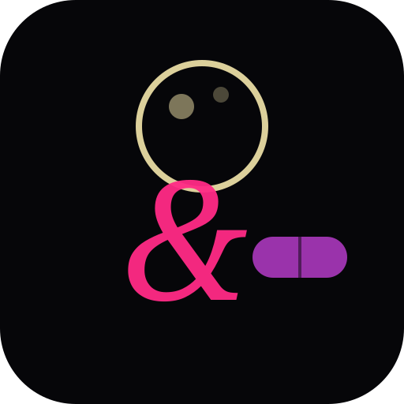

# champagne&pills 🍾💊

> **Dark Editorial Lounge & Personal Media Hub** — замена десяткам закрепленных вкладок в браузере для лекций, видеоэссе, курсов и аниме.



---

## ✨ Ключевые возможности

### 1. 🎨 Эстетика Late-Night Lounge & Neon (Awwwards Style)
- **4 неоновые темы оформления**:
  - `Champagne & Rose` (золотистый `#f3e5ab` + розовый неон `#ff2a85` — по умолчанию)
  - `Cyber Violet` (кибер-фиолетовый + аквамарин)
  - `Emerald Noir` (изумрудный монохром)
  - `Crimson Velvet` (рубиновый нуар)
- **Кастомный фон в IndexedDB**: загрузка любого изображения с ПК или вставка из буфера (`Ctrl+V`), автоматическое сжатие в WebP до 900px, плавные ползунки затемнения (0–90%) и размытия (0–30px).
- **Типографика**:
  - `Playfair Display` (курсив для акцентных заголовков и брендинга `champagne`)
  - `Plus Jakarta Sans` (четкий современный гротеск для интерфейса и `pills`)
  - `JetBrains Mono` (все цифры, счетчики серий, таймкоды, бейджи и хоткеи)

### 2. ⚡ Быстрый ввод и умный автопарсинг
- **Глобальный перехват `Ctrl+V`**: находясь в любом месте сайта вне полей ввода, нажмите `Ctrl+V` со скопированной ссылкой — модалка создания закрепа откроется автоматически с предзаполненными данными.
- **Хоткей `N`**: быстрое создание нового закрепа в одно нажатие.
- **Автопарсинг без API-ключей**:
  - YouTube (полноразмерные постеры `hqdefault`, автоматическое извлечение названий и авторов через oEmbed)
  - Rutube, VK, Vimeo, Web, Anime
- **Drag-and-Drop постеров**: перетаскивание картинки или вставка постера прямо из буфера обмена со сжатием в WebP.

### 3. 🏛️ Подпериоды истории (ЕГЭ / Олимпиады)
- Фильтрация и каталогизация по ключевым историческим эпохам:
  - *Древняя Русь*
  - *Удельный период*
  - *Московское царство*
  - *Петр I — Екатерина II*
  - *Империя: XIX — нач. XX в.*
  - *СССР: Ленин / Сталин / ВОВ*
  - *Поздний СССР*
  - *Культура и Историография*

### 4. 🎬 Split-Screen Кинозал & Конспекты
- Встроенный 16:9 плеер с атмосферной подсветкой **Ambilight**.
- Таймкод остановки с автоматической генерацией прямых ссылок (`&t=...`).
- Конспект лекций в реальном времени с поддержкой Markdown и кнопкой мгновенного копирования в буфер обмена.
- **Таймкод-маркеры**: сохранение ключевых моментов видео с переходами в 1 клик.
- **Эпизод-трекер**: кнопки `-` / `+1` для аниме и сериалов, прогресс-бар и выбор студии озвучки.

### 5. 🧘 Модуль концентрации & Pomodoro
- Режимы таймера: `45 / 10 мин (Deep Work)` и `25 / 5 мин (Классика)`.
- **Генератор шума на Web Audio API**:
  - *Brown Noise* (глубокий ровный спектр для подавления отвлекающих шумов)
  - *Rain Noise* (успокаивающий шум дождя с модуляцией)
  - Регулировка громкости
- Нативные уведомления браузера об окончании фазы.

### 6. 🎲 Медиа-рулетка & Command Palette (`Ctrl+K`)
- **Рулетка**: анимированный случайный выбор из очереди закрепов (`queued`).
- **Command Palette (`Ctrl+K`)**: быстрый глобальный поиск по заголовкам, авторам, тегам, ссылкам Quick Dock и командам навигации с управлением стрелками.

### 7. 💾 Безопасность и хранение данных
- **Локальное хранилище**: `localStorage` для метаданных + `IndexedDB` для тяжелых обложек и обоев.
- **Корзина & 6-секундный Undo Toast**: случайное удаление легко отменяется прямо из всплывающего уведомления.
- **Экспорт и импорт в JSON**: резервное копирование в файл или буфер обмена для переноса между устройствами без сторонних серверов.

---

## ⌨️ Горячие клавиши

| Сочетание | Действие |
|---|---|
| `Ctrl+V` / `Cmd+V` (вне инпутов) | Мгновенно открыть модалку и распарсить ссылку из буфера |
| `N` (вне инпутов) | Открыть окно создания нового закрепа |
| `Ctrl+K` / `Cmd+K` | Открыть Command Palette (поиск и команды) |
| `Esc` | Закрыть любое активное модальное окно |

---

## 🚀 Запуск и сборка

```bash
# Установка зависимостей
npm install

# Запуск локального сервера разработки
npm run dev

# Проверка типов и сборка в dist
npm run build

# Деплой на GitHub Pages
npm run deploy
```

---

## 📦 PWA & Десктоп

Приложение полностью адаптировано как **Progressive Web App (PWA)**:
1. Откройте сайт в Chrome / Edge / Brave / Safari.
2. Нажмите иконку «Установить» в адресной строке браузера.
3. Приложение откроется в отдельном окне без адресной строки и рамок браузера как нативный десктопный клиент.

---
*champagne&pills • 2026*
